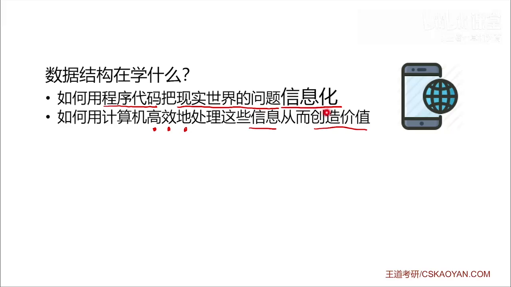
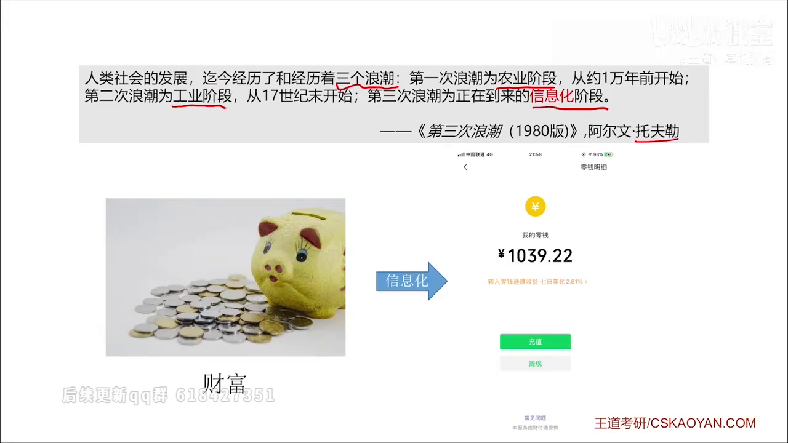
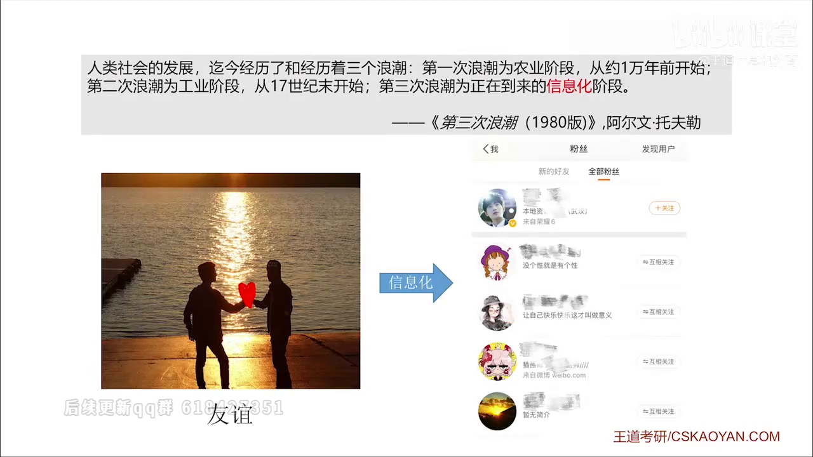
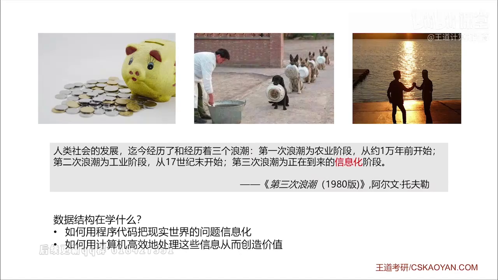
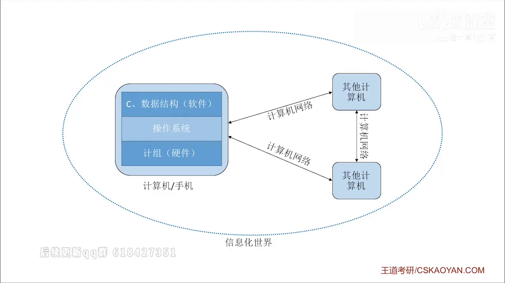
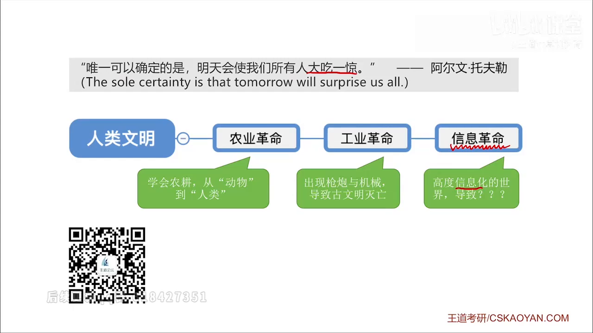
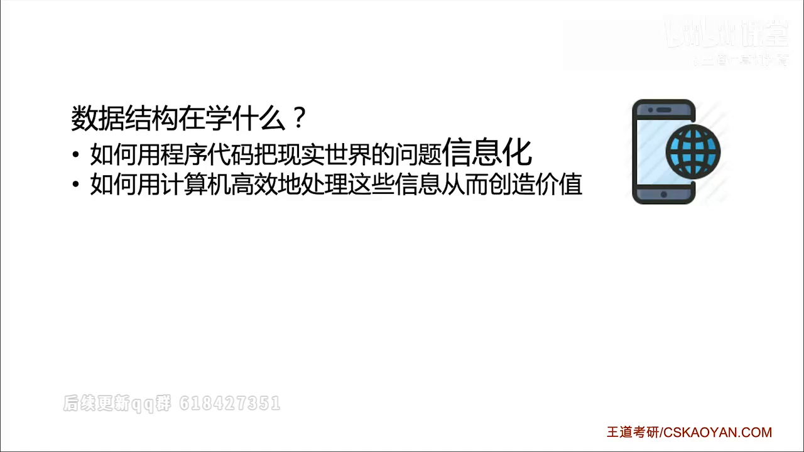

# 00 开篇：为什么学数据结构

| 项目 | 内容 |
| --- | --- |
| 课程 | 数据结构 |
| 来源 | `[2]--1.0_开篇_数据结构在学什么.mp4` |
| 教材 | 第 1 章 1.1，PDF 第 13-16 页，书页 1-4 |
| 定位 | 导学框架，不是独立的 408 考点 |
| 复习建议 | 首轮理解一次即可，后续不必反复回看 |

> 图片均从原视频提取，保留完整课件页面；下方文字用于提炼课程框架。



## 一句话结论

视频的中心句可以作为整门课的总问题：

> 怎样用程序把现实世界的问题表示成计算机能处理的信息，再选择合适的数据组织方式和运算，高效地处理这些信息？

这句话本身不直接考，但它对应了数据结构题目最核心的思考顺序：

**现实问题 → 选择逻辑结构 → 选择存储结构 → 定义运算 → 分析时间和空间代价**

后续做算法题时，确定“数据怎么组织”和“操作怎样实现”比一上来写代码更重要。

## 视频内容与教材概念的对应

视频用了三个生活例子。换成考试语言后，它们正好对应不同层次的数据结构：





| 视频中的例子 | 教材中的概念 | 后续落点 |
| --- | --- | --- |
| 六位数财富 | 用一个变量表示一个数据项；变量的取值范围和操作属于数据类型 | C 语言基础、数据表示 |
| 餐厅排号 | 排队元素之间存在一对一的先后关系，是线性结构；可用数组或队列实现 | 第 2 章线性表、第 3 章队列 |
| 微博用户互相关注 | 用户之间存在多对多的网状关系，是非线性结构 | 第 6 章图 |

教材进一步指出：数据元素不是孤立存在的，元素之间存在的一种或多种特定关系，才构成了“结构”。因此，只保存元素的值还不够，还要保存元素之间的关系。




## 教材补充：基本概念链

### 数据、数据元素、数据项

- **数据**：信息的载体，是描述客观事物属性的数、字符及能够被计算机程序识别和处理的符号集合。
- **数据元素**：数据的基本单位，通常作为一个整体处理。
- **数据项**：构成数据元素的不可分割的最小单位。

例如：

```text
学生记录 = 一个数据元素
学号、姓名、性别 = 该数据元素中的不同数据项
所有学生记录 = 一个数据对象
```

- **数据对象**：具有相同性质的数据元素的集合。

这三个概念常以“谁是数据元素、谁是数据项”的选择题出现，必须能结合具体例子区分。

### 数据类型与抽象数据类型

**数据类型**包含两部分：

1. 一组可能取值的集合；
2. 定义在这组值上的一组操作。

**抽象数据类型 ADT** 是用数学模型描述逻辑结构和抽象操作，不规定这些操作在计算机中怎样存储、怎样实现。

可以记成：

> 数据类型关心“值域 + 操作”，ADT 关心“逻辑模型 + 抽象操作”，二者都不等同于具体存储实现。

## 数据结构三要素

教材把数据结构概括为三个不可缺少的方面：

1. **逻辑结构**：数据元素之间的逻辑关系，与计算机无关。
2. **存储结构**：逻辑结构在计算机中的表示，也称物理结构。
3. **数据的运算**：包括运算的定义和实现。

缺掉存储结构和运算，只谈元素之间的关系，并不能构成一个完整的数据结构定义。

### 1. 逻辑结构

按元素间的关系可分为：

| 类型 | 关系 | 典型例子 |
| --- | --- | --- |
| 集合 | 除“同属一个集合”外没有其他关系 | 集合 |
| 线性结构 | 一对一 | 线性表、栈、队列、串 |
| 树形结构 | 一对多 | 一般树、二叉树 |
| 图状结构 | 多对多 | 有向图、无向图 |

逻辑结构只描述数据元素之间“是什么关系”，不规定这些关系在内存中怎样保存。

### 2. 存储结构

| 存储方式 | 核心思路 | 主要优点 | 主要代价 |
| --- | --- | --- | --- |
| 顺序存储 | 逻辑上相邻，物理位置也相邻 | 可随机存取，存储密度高 | 需要连续空间，插入删除可能移动大量元素 |
| 链式存储 | 用指针表示逻辑关系，不要求物理相邻 | 插入删除灵活，不必连续分配空间 | 指针占额外空间，通常只能顺序访问 |
| 索引存储 | 额外建立“关键字 → 地址”的索引表 | 查找速度较快 | 索引表占空间，更新索引有额外开销 |
| 散列存储 | 由关键字直接计算存储地址 | 查找、插入、删除通常很快 | 可能冲突，需要设计散列函数和处理冲突 |

必须区分：

- **逻辑结构独立于存储结构**：同一种逻辑结构可以有多种存储方式。
- **存储结构不能脱离逻辑结构**：存储结构是逻辑结构在计算机中的映射。

### 3. 数据的运算

- **运算的定义**：站在逻辑结构层面，说明这个运算要完成什么功能。
- **运算的实现**：站在存储结构层面，说明具体怎样操作。

同一个逻辑结构如果采用不同存储方式，即使实现的是同一种运算，效率也可能完全不同。

典型例子：

- 在线性表中插入或删除元素：
  - 顺序存储通常要移动大量元素，平均为 $O(n)$；
  - 链式存储只要已经定位到操作位置，修改指针即可，为 $O(1)$。

## 408 易错点

1. **“数据结构就是数据的集合”不完整。**  
   数据元素之间还必须存在一种或多种特定关系，并包含相应运算。

2. **逻辑结构不等于存储结构。**  
   “线性表”首先描述一种线性逻辑关系；顺序表和链表是它的不同存储实现。

3. **ADT 不等于具体实现。**  
   ADT 描述逻辑结构和抽象操作，不规定必须用数组、链表还是其他存储方式。

4. **“有序表”是逻辑层面的概念。**  
   它只要求元素按关键字有序，既可以用顺序存储，也可以用链式存储。

5. **存储结构不是可有可无的附属品。**  
   数据结构三要素缺一不可；讨论算法效率时必须同时看逻辑结构和具体存储实现。

6. **同一逻辑结构、同一运算，不代表同一效率。**  
   顺序表和链表是理解这一点最直接的例子，也是第 2 章算法题的基础。

## 这节课与 408 的真实关系

这一讲没有新增可直接作答的考点，价值主要有两个：

1. 给出整门课的问题框架；
2. 说明为什么后续既要研究“数据之间是什么关系”，又要研究“怎样存储、怎样操作、代价多大”。

教材对第 1 章的复习提示也指出：本章属于数据结构概述，**并不在考研大纲中**；但算法的时间复杂度和空间复杂度是本章重点，算法设计题也通常要求分析复杂度。





因此，本讲不需要过度记忆，真正需要重点掌握的是后续的：

- 数据结构三要素及其判断；
- 时间复杂度与空间复杂度分析；
- 针对具体问题选择合适的数据结构。



## 自测

1. 数据元素、数据项和数据对象分别是什么？用“学生记录”举例说明。
2. 为什么“只存了元素的值”不等于“定义了完整的数据结构”？
3. 抽象数据类型是否规定了数据的存储结构？为什么？
4. 同一种逻辑结构能否采用不同存储结构？请举两个例子。
5. 为什么顺序表和链表可以具有相同的逻辑结构，却具有不同的操作效率？

## 后续补充位置

- 学完 1.2 后，在本章笔记中补充时间复杂度和空间复杂度的统一分析框架。
- 学完第 2、3 章后，把“线性表、栈、队列”的具体存储与操作补到逻辑结构分类下面。
- 学完第 6 章后，把“用户关注关系”正式落到图的存储结构和遍历方法。
