# 1.1 数据结构的基本概念

| 项目 | 内容 |
| --- | --- |
| 课程 | 数据结构 |
| 来源 | `[3]--1.1_数据结构的基本概念.mp4` |
| 教材 | 第 1 章 1.1，PDF 第 13-16 页，书页 1-4 |
| 定位 | 概念辨析与全书框架 |
| 重点 | 数据结构 vs 数据对象、三要素、运算的定义与实现、ADT |

> 图片均从原视频提取，保留完整课件页面；下方文字用于归纳考点、区分易错概念和补充教材内容。

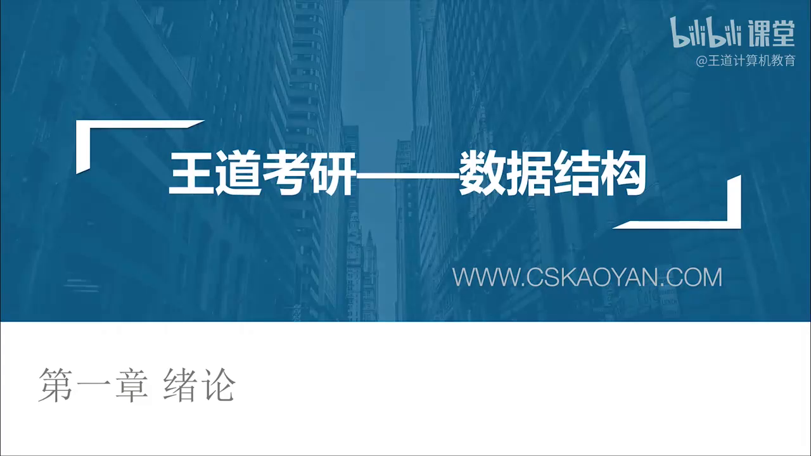

## 一句话结论

**数据元素不是孤立的一组值；元素之间还必须存在关系，并配上相应运算，才构成数据结构。**

学习任何一种数据结构，都从三个问题入手：

1. 元素之间是什么逻辑关系？
2. 这种逻辑关系在计算机中怎样存储？
3. 要对它做哪些运算，具体怎样实现？

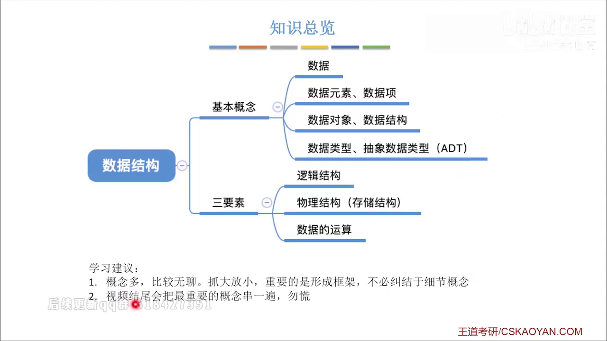

## 一、基本概念链

### 数据的范围

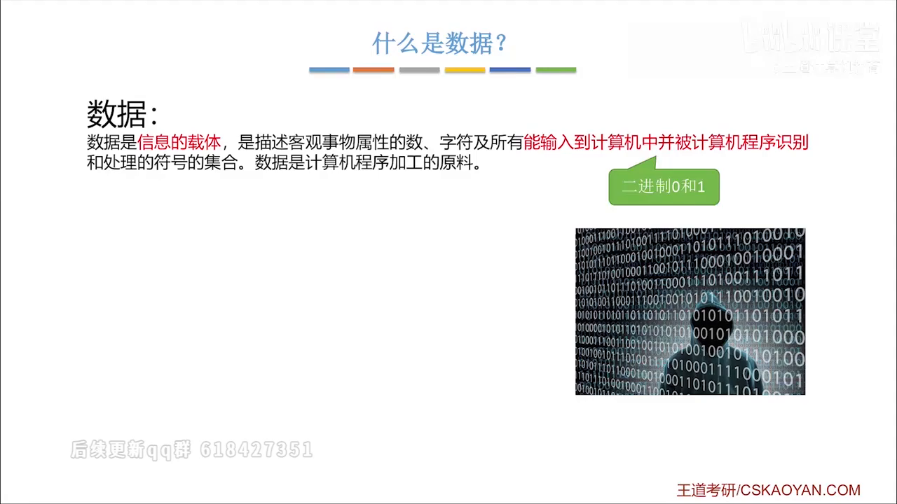

| 概念 | 核心定义 | 关键区别 |
| --- | --- | --- |
| 数据 | 信息的载体，是能被计算机程序识别和处理的符号集合 | 范围最大 |
| 数据元素 | 数据的基本单位，通常作为一个整体处理 | 可以由多个数据项组成 |
| 数据项 | 构成数据元素的不可分割的最小单位 | 不可再分 |
| 数据对象 | 具有相同性质的数据元素的集合 | 只要求性质相同，不要求元素之间有特定关系 |
| 数据结构 | 相互之间存在一种或多种特定关系的数据元素的集合 | 必须强调元素之间的关系 |

### 用排队系统理解

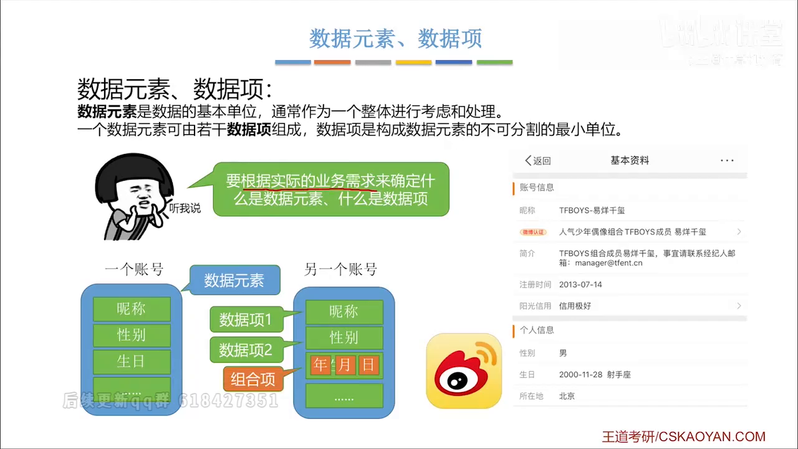

在餐厅排号系统中，可以这样划分：

```text
一波顾客的排队信息 = 一个数据元素
号码、取号时间、就餐人数 = 该数据元素中的数据项
全国所有门店的排队顾客信息 = 一个数据对象
某个门店中按号码先后排队的信息 = 一个数据结构
```

其中：

- **数据对象**只关心“这些元素具有相同性质”。
- **数据结构**还必须关心“这些元素之间有什么关系”。

同一组数据元素，是否构成数据结构，要看是否讨论它们之间的特定关系。

> “数据元素”和“数据项”没有脱离业务场景的绝对边界。要根据实际处理的问题，决定什么作为一个整体、什么作为整体中的组成项。

### 什么是“结构”

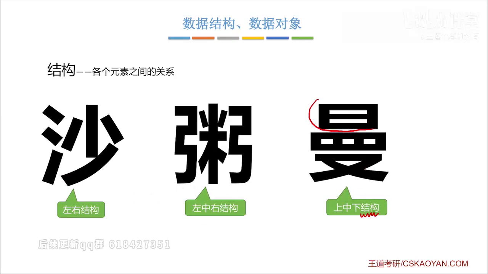

“结构”不是指元素本身，而是指元素之间的联系方式。汉字有左右、上下结构；排队有先后结构；文件目录有层次结构。

### 数据结构与数据对象

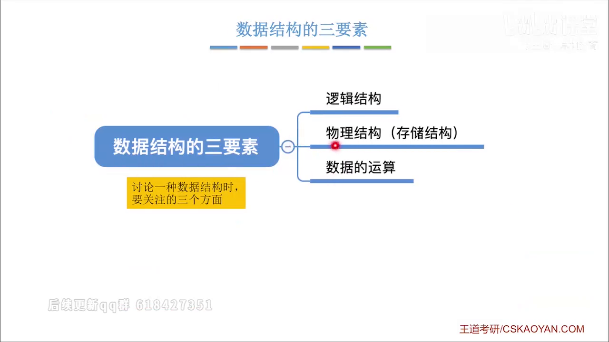

两者的判断标准不同：

- **数据对象**：只要求元素性质相同；
- **数据结构**：还要求元素之间存在一种或多种特定关系。

## 二、数据结构的三个要素

数据结构的三要素包括：

1. **逻辑结构**：数据元素之间的逻辑关系，例如集合、线性、树形和图状结构。
2. **存储结构（物理结构）**：逻辑结构在计算机中的表示，包括顺序、链式、索引和散列存储。
3. **数据的运算**：根据逻辑结构定义需要完成什么操作，再根据存储结构实现具体操作。

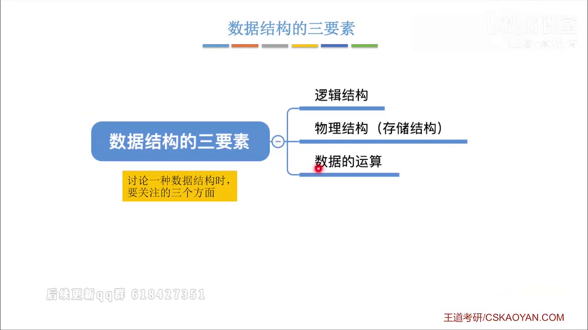

### 1. 逻辑结构

逻辑结构描述数据元素之间的逻辑关系，不涉及它们在计算机中怎样存储。

| 逻辑结构 | 元素间关系 | 直观例子 |
| --- | --- | --- |
| 集合 | 除同属一个集合外，没有其他关系 | 同一烤盘上的食物 |
| 线性结构 | 一对一 | 排队、烤串、线性表、栈、队列 |
| 树形结构 | 一对多 | 思维导图、文件目录、树、二叉树 |
| 图状或网状结构 | 多对多 | 微信好友关系、无向图、有向图 |

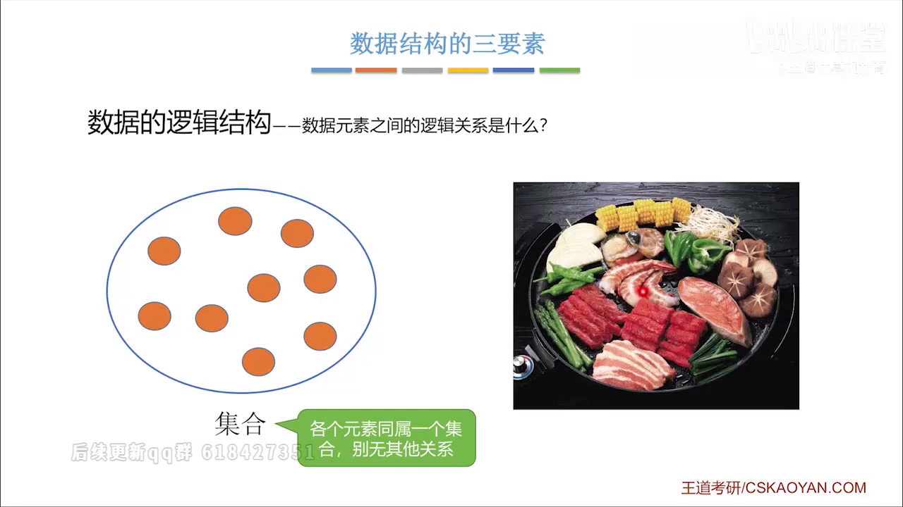

#### 集合结构

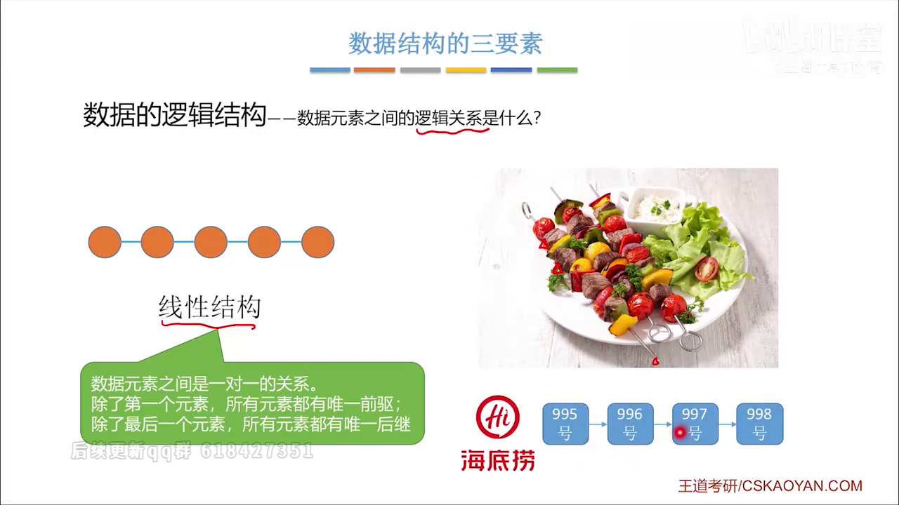

元素之间除了“同属一个集合”外没有其他关系。

#### 线性结构

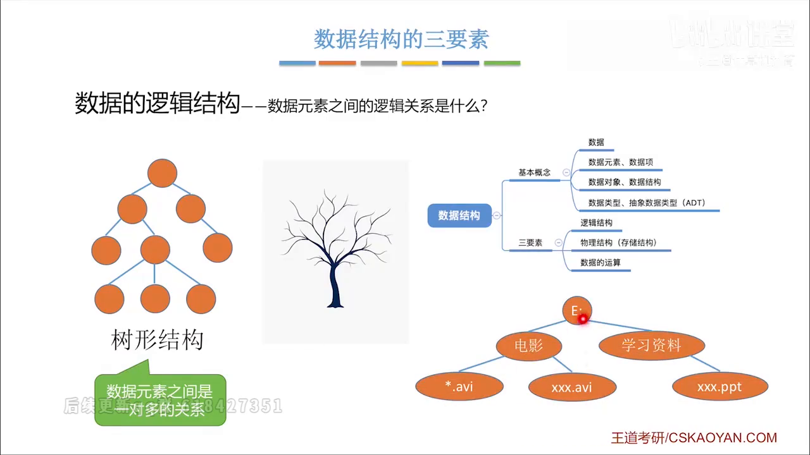

元素之间是一对一关系；除首元素外各有唯一前驱，除尾元素外各有唯一后继。

#### 树形结构

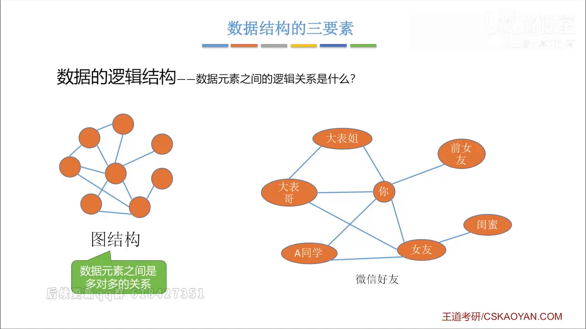

元素之间是一对多关系，典型例子是目录、思维导图和二叉树。

#### 图状结构

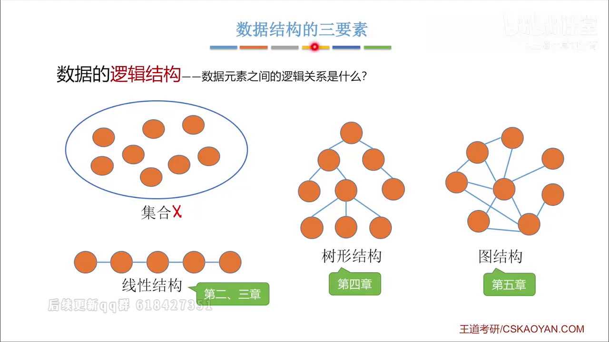

元素之间是多对多关系，典型例子是好友关系和交通网络。

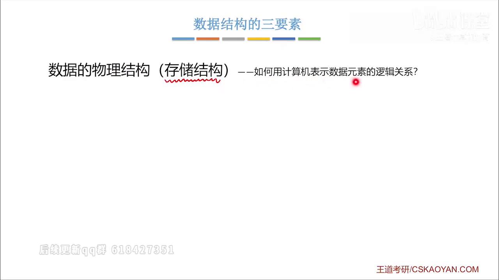

线性结构要抓住前驱和后继：

- 第一个元素没有前驱；
- 最后一个元素没有后继；
- 其余元素各有唯一前驱和唯一后继。

集合结构在本课程中基本不单独展开。后续主要学习：

- 第 2、3 章：线性结构；
- 第 5 章：树形结构；
- 第 6 章：图状结构。

### 2. 存储结构

存储结构又叫物理结构，研究逻辑关系怎样在计算机中表示。

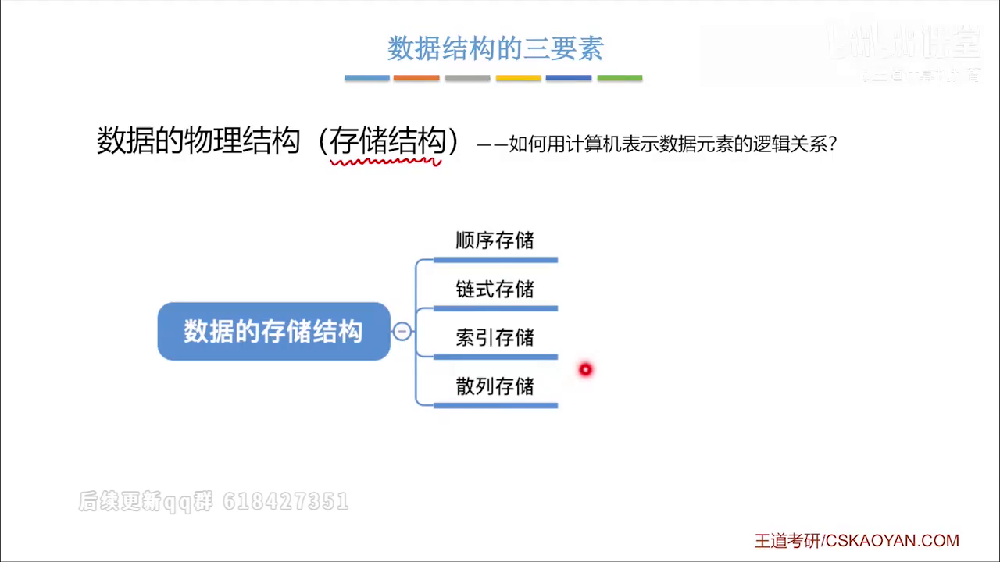

| 存储结构 | 表示关系的方法 | 特点 |
| --- | --- | --- |
| 顺序存储 | 用物理位置相邻表示逻辑相邻 | 必须占用连续空间，可随机访问 |
| 链式存储 | 用指针记录下一个元素的地址 | 不要求物理位置相邻，但需要额外指针空间 |
| 索引存储 | 建立“关键字 → 地址”的索引表 | 用额外索引表换取更快的查找 |
| 散列存储 | 由关键字直接计算存储地址 | 查找通常很快，但要处理冲突 |

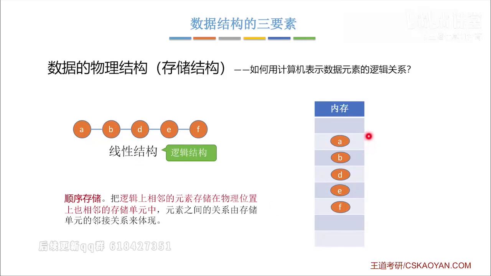

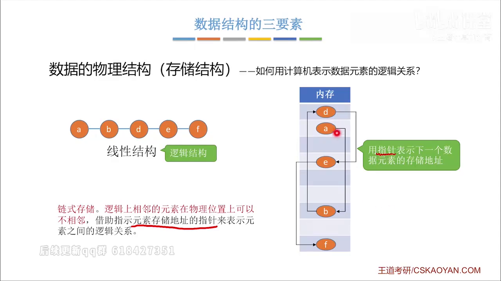

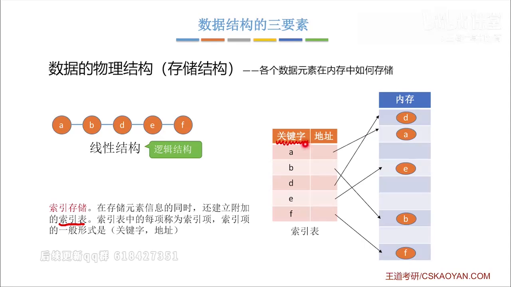

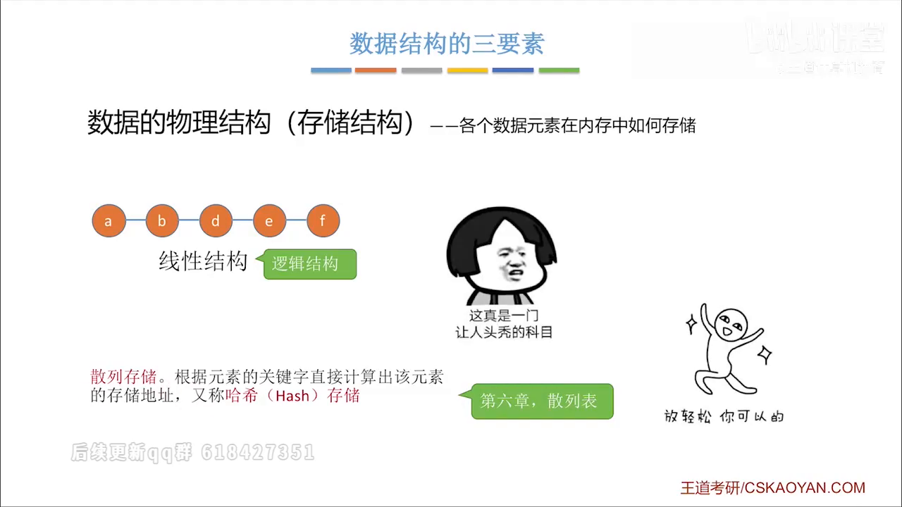

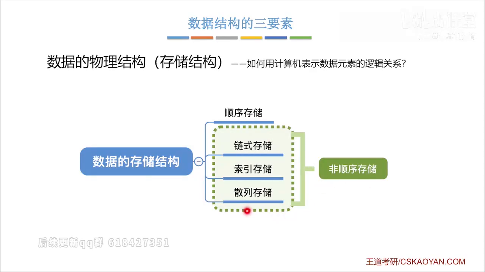

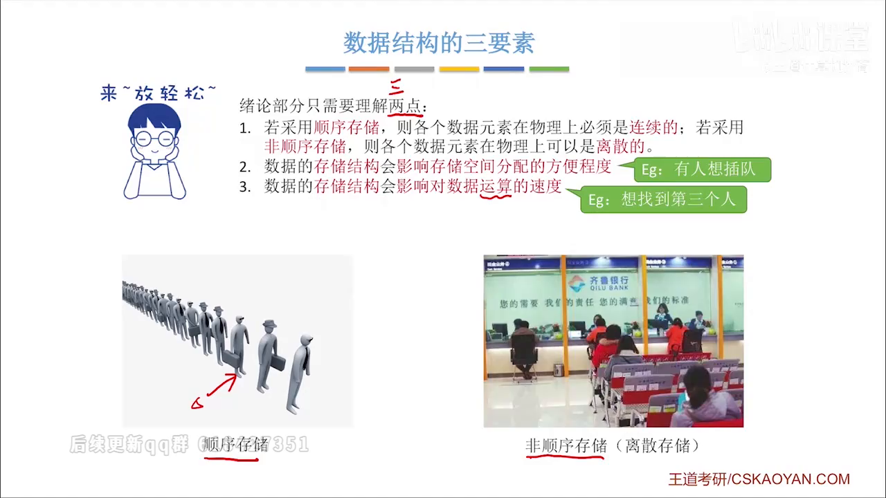

通常把链式、索引和散列存储统称为**非顺序存储**：

- 顺序存储中，数据元素在物理上必须连续；
- 非顺序存储中，数据元素在物理上可以是离散的。

**关键字**是能够区分不同数据元素的数据项。例如排队号码可以唯一区分每一波顾客，因此可作为关键字。

存储结构至少会从两个方向影响算法：

1. **空间分配的方便程度**：顺序存储插入元素时可能要让后面的元素整体后移；链式存储只需调整指针。
2. **运算速度**：顺序存储可以直接定位第 $i$ 个元素；链式存储通常要沿指针逐个寻找。

#### 补充辨析：索引存储与散列存储

> 以下为概念补充，不是本讲原课件内容。

两种结构在逻辑上都可以看成“键 → 值”的映射，但它们在计算机中保存这个映射的方式不同：

- **索引存储**：额外保存一张索引表，显式记录“关键字 → 地址”。
- **散列存储**：不保存这样的地址索引表，而是通过哈希函数由关键字直接计算存储位置。

以“学号 → 学生记录”为例：

```text
索引存储：学号 → 索引表（学号，地址）→ 学生记录
散列存储：学号 → h(学号) → 哈希桶 → 学生记录
```

| 对比项 | 索引存储 | 散列存储 |
| --- | --- | --- |
| 映射保存在哪里 | 一张独立的索引表中 | 由哈希函数即时计算得到 |
| 索引项或桶中保存什么 | 通常是“关键字 + 存储地址” | 通常是“关键字 + 实际数据”或指向数据的指针 |
| 数据本身在哪里 | 可以在索引表之外的其他存储区域 | 通常在哈希桶中，或由桶指向实际数据 |
| 查找路径 | 查索引表得到地址，再读取数据 | 计算哈希值定位桶，再读取数据 |
| 是否强调顺序 | 可以建立有序索引 | 通常不保留元素的顺序 |
| 主要关注点 | 索引表空间、维护索引的代价 | 哈希函数、冲突处理和装填因子 |

核心区别：

> **索引表把“键对应哪个存储地址”明确保存下来；散列表则通过哈希函数把这个地址直接计算出来。**

### 3. 数据的运算

数据运算要区分两个层次：

- **运算的定义**：站在逻辑结构层面，说明要完成什么功能。
- **运算的实现**：站在存储结构层面，说明具体怎样操作。

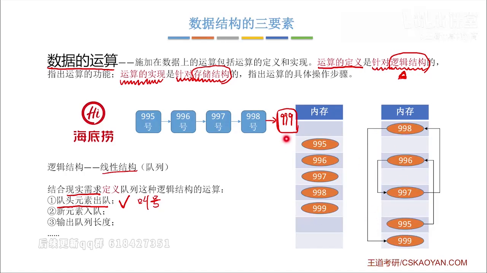

例如，队列需要定义“入队”和“出队”：

- 定义只说明新元素从队尾进入、队头元素离开；
- 用顺序存储或链式存储实现时，具体代码完全不同。

因此：

> 同一种逻辑结构和同一种运算，换一种存储方式后，实现方式和运行效率都可能改变。

## 三、数据类型与抽象数据类型

### 数据类型

数据类型由两部分组成：

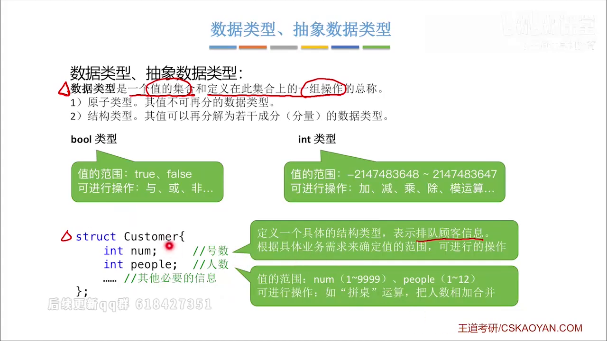

1. 一组可能取值的集合；
2. 定义在这组值上的一组操作。

#### 原子类型

值不可再分。例如：

- `bool`：取值通常为 `true`、`false`，可做与、或、非等操作；
- `int`：有确定的整数取值范围，可做加、减、乘、除、取模等操作。

#### 结构类型

值可以继续分解成若干分量。例如 C 语言中的结构体：

```c
struct Customer {
    int num;      // 排队号码
    int people;   // 就餐人数
};
```

它的取值范围和可执行操作由具体业务决定，例如：

- `num` 限定在某个号码范围内；
- `people` 限定在某个就餐人数范围内；
- 可以定义“拼桌”操作，把两波顾客的人数合并。

### 抽象数据类型 ADT

抽象数据类型是抽象的数据组织及与之相关的操作。

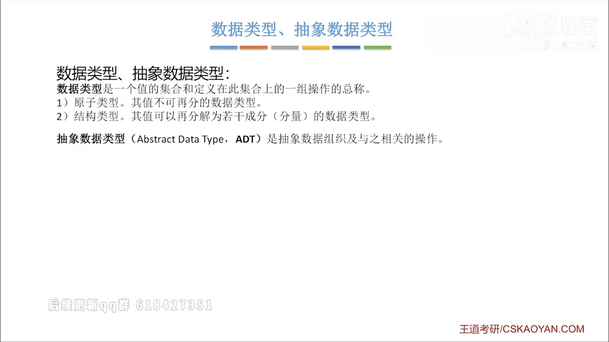

用已经学过的三要素来理解：

- ADT 用数学化语言定义**逻辑结构**；
- ADT 定义**数据的运算**；
- ADT **不规定具体存储结构**，也不讨论运算的具体实现。

只有在计算机中真正实现这个数据结构时，才需要进一步选择顺序、链式、索引或散列存储。

可以用下面的层次理解：

```text
抽象数据类型：逻辑关系 + 抽象运算
        ↓ 选择存储方式
具体实现：存储结构 + 运算实现
```

选择题中常见的结论是：

> 抽象数据类型可以用“数据对象、数据关系、基本操作集”来刻画，因此可以用来定义一个完整的数据结构。

这里的“完整”是指抽象定义完整，不代表已经确定了计算机中的存储实现。

## 四、408 易错点

1. **数据结构不等于数据对象。**  
   数据对象只要求元素性质相同；数据结构还必须强调元素间的特定关系。

2. **逻辑结构不等于存储结构。**  
   队列在逻辑上是一对一的线性结构，但既可以顺序存储，也可以链式存储。

3. **“线性”不等于“连续存放”。**  
   线性结构描述的是逻辑关系，不代表元素在物理内存中一定相邻。

4. **顺序存储和链式存储不是逻辑结构的分类。**  
   它们只是同一逻辑结构的不同物理实现方式。

5. **ADT 不规定存储结构。**  
   ADT 关注逻辑模型和抽象操作；具体采用数组还是链表属于实现阶段。

6. **运算也是数据结构的组成部分。**  
   两种数据结构即使逻辑结构和存储结构相同，只要运算语义不同，也可以是不同的数据结构。  
   例如，普通二叉树与二叉排序树的组织方式可以相似，但查找运算的规则和效率不同。

7. **存储结构不同，会改变运算效率。**  
   在线性表中按位置插入或删除元素时：
   - 顺序存储通常要移动大量元素，平均为 $O(n)$；
   - 链式存储如果已经定位到操作位置，修改指针即可，为 $O(1)$。

8. **“有序表”属于逻辑层面的概念。**  
   它只要求元素按关键字有序，可以用顺序存储，也可以用链式存储。

9. **存储数据元素时，不仅保存值，还要保存关系。**  
   如果只保存每个元素的数值，而不保存元素之间的逻辑联系，就无法恢复完整的数据结构。

## 五、快速自测

1. 数据元素、数据项、数据对象三者如何区分？
2. 为什么“数据对象的集合”不一定已经是“数据结构”？
3. 逻辑结构分为哪四类？各自的关系是什么？
4. 顺序、链式、索引、散列存储分别怎样表示元素之间的关系？
5. 运算的定义和运算的实现分别针对什么层面？
6. 为什么 ADT 不需要规定存储结构？
7. 两种数据结构如果逻辑结构和存储结构都相同，还可能不同吗？

## 六、本小节怎么复习

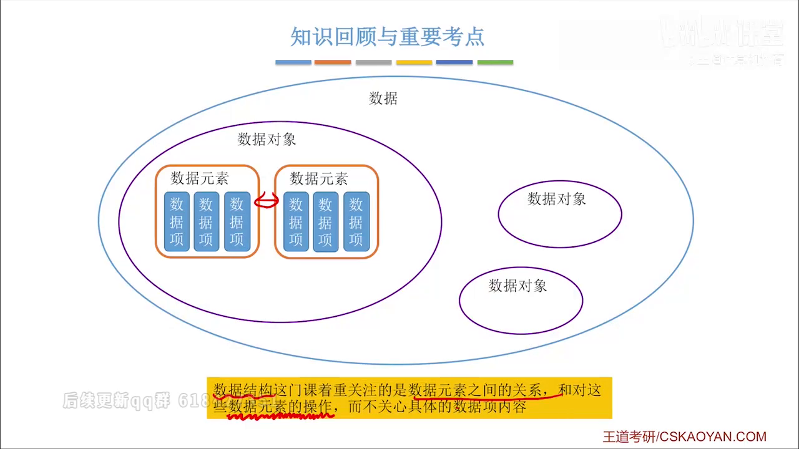

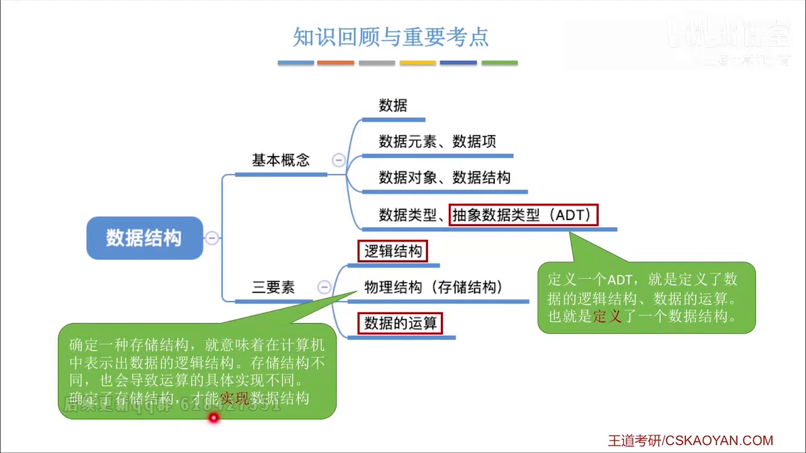

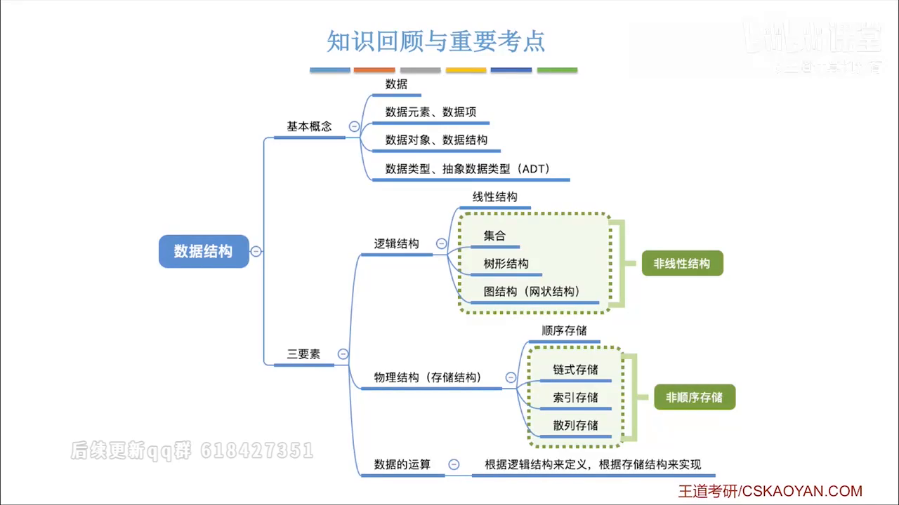

这一小节概念多，但不需要逐字背诵。第一轮抓住以下判断链即可：

```text
是不是在讨论元素之间的关系？
        ↓ 是
关系是一对一、一对多，还是多对多？
        ↓
选择什么存储方式表示这种关系？
        ↓
需要定义哪些运算？不同存储方式下怎样实现？
```

真正需要熟记的是概念之间的边界，而不是视频中的具体生活例子。后续学习线性表、栈、队列、树和图时，每个章节都会重复使用这套三要素框架。
